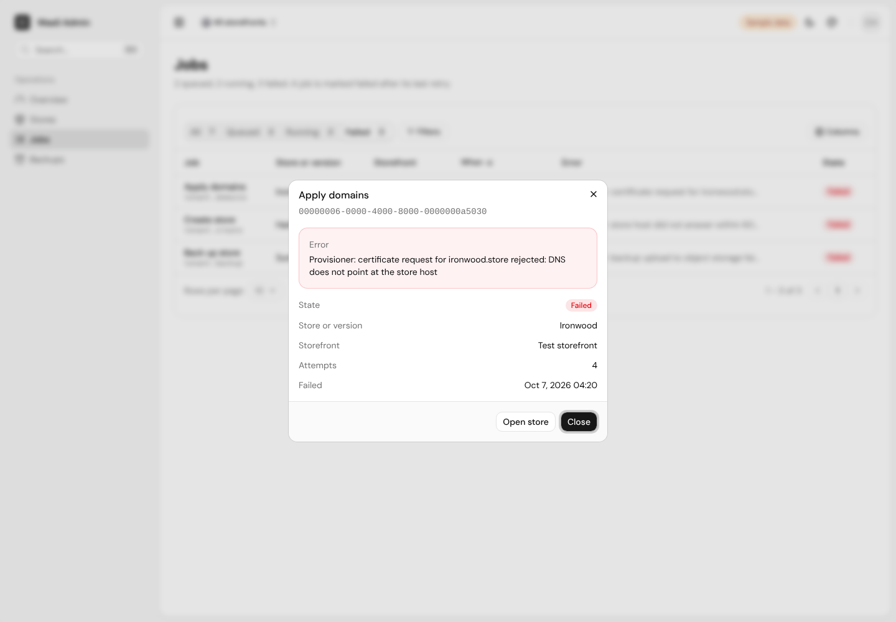

# waas-dashboard

Admin dashboard for the WaaS platform. It reads the provisioning API ([`waas-provisioning-api`](https://github.com/hamchowderr/waas-provisioning-api)) and shows:

- **Overview**: whether the API, its database and its job queue are up, store counts by status, queued and failed background jobs, backup totals.
- **Stores**: every store (tenant) across all storefronts, with storefront, version, domains, status and last backup. Each store has a page with its domains, backups, settings names and jobs.
- **Jobs**: queued, running and failed background jobs, with the error of each failed one.
- **Backups**: every backup, including those of deleted stores, with when each expires.

The storefront switcher in the header narrows the pages to one storefront (`?product=<id>` in the URL).

Version 1 is read-only: it changes nothing in the API.

Next.js 16 (App Router), React 19, Tailwind CSS v4 and the [Shadcn UI Kit](https://shadcnuikit.com) dashboard shell and pages. Hosted on Vercel.


## How it gets its data

All API calls run on the server (`lib/api/`). The browser never sees the API address or the admin token.

| Source | When |
|---|---|
| The live API's `/admin/*` endpoints, with `Authorization: Bearer $WAAS_ADMIN_TOKEN` | `WAAS_API_URL` and `WAAS_ADMIN_TOKEN` are set |
| Built-in sample data (`lib/api/fixtures.ts`), with a "Sample data" badge in the header | `WAAS_API_FIXTURES=1` |

With neither, pages show an error rather than sample data, so a missing variable is never mistaken for real data.

`lib/api/wire.ts` mirrors the API's `openapi/admin/admin-api.yaml` (v0.1.0, beads `waas-api-plu.1`). `lib/api/http.ts` maps those bodies to the page types in `lib/api/types.ts`, and adds the store and storefront names that the backups and jobs lists carry only as ids. Lists are read whole (up to 2,000 rows each, in pages of 200) and filtered in the browser.

## Sign-in

[Auth.js](https://authjs.dev) with GitHub. Only the GitHub logins in `ALLOWED_GITHUB_LOGINS` can sign in, and the list is checked on every request, so removing a login locks it out straight away. Sessions are signed cookies (12 hours); there is no user database.

To set it up, create a GitHub OAuth app (GitHub → Settings → Developer settings → OAuth Apps → New OAuth App):

| Field | Value |
|---|---|
| Homepage URL | the dashboard's address, e.g. `https://waas-dashboard.vercel.app` |
| Authorization callback URL | the same address + `/api/auth/callback/github` |

Its Client ID goes in `AUTH_GITHUB_ID` and a generated client secret in `AUTH_GITHUB_SECRET`. GitHub allows one callback URL per OAuth app, so local development needs a second OAuth app with `http://localhost:3000` and `http://localhost:3000/api/auth/callback/github`.

## Environment variables

| Name | Needed for | Notes |
|---|---|---|
| `WAAS_API_URL` | live data | e.g. `https://waas-api.otakusolutions.io` |
| `WAAS_ADMIN_TOKEN` | live data | the API's `ADMIN_TOKEN`; server-side only |
| `WAAS_API_FIXTURES` | sample data | `1` to use the built-in sample data |
| `AUTH_SECRET` | sign-in | random, e.g. `openssl rand -base64 32` |
| `AUTH_GITHUB_ID`, `AUTH_GITHUB_SECRET` | sign-in | from the GitHub OAuth app |
| `ALLOWED_GITHUB_LOGINS` | sign-in | GitHub usernames, comma separated |
| `SHADCNUIKIT_API_KEY` | adding kit components | development only, see below |

`.env.example` lists them. Vercel reads its variables when it builds, so a changed variable takes effect on the next deployment.

## Develop

```sh
npm install
cp .env.example .env.local   # fill in, or set WAAS_API_FIXTURES=1
npm run dev
```

Checks (CI runs the same on every pull request):

```sh
npm run typecheck
npm run lint
npm run build
```

## Shadcn UI Kit

The layout (`components/layout/`, `components/theme-customizer/`) is the kit's Dashboard Shell. The tables (`components/admin/data-table.tsx`) are adapted from the kit's Orders page and use its filter builder (`components/ui/filters/`). The Overview uses the kit's stat-card5 and chart39 blocks. Kit and shadcn/ui files are kept as shipped where possible, so `eslint.config.mjs` relaxes a few rules for those folders only.

`components.json` has the kit's private registry. With `SHADCNUIKIT_API_KEY` in the environment:

```sh
npx shadcn@latest add @shadcnuikit/<name>
```

The key is only needed to add components; builds don't use it. Never commit the key, or any install link the kit's MCP server returns (they carry a token).

## Screenshots

From a local run with sample data:

| | |
|---|---|
|  |  |
|  |  |
|  |  |
