# WaaS Dashboard

The admin dashboard for the [WaaS provisioning API](https://github.com/hamchowderr/waas-provisioning-api): one place to see and manage every customer website the API runs, across all your storefronts. It is the dashboard behind [AnyPress](https://anypress.io) and is open source under GPL-3.0.

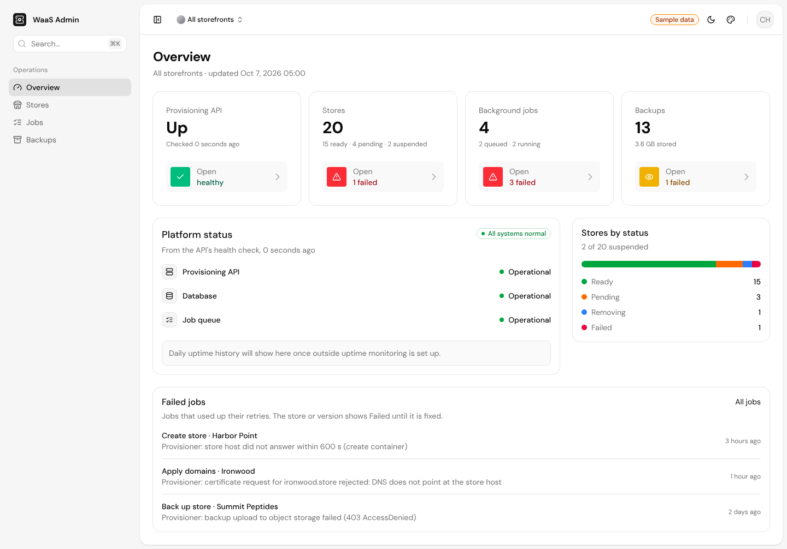

## What you can do

- **Overview:** whether the API, its database and its job queue are up, website counts by status, queued and failed jobs, backup totals.
- **Stores:** every customer website, with its storefront, version, domains, status and last backup. Each website has its own page, where you can:
  - **Change address:** make another domain the website's main address. The old one keeps redirecting.
  - **Email sender:** let the website send email from its owner's own domain, with the DNS records to add and whether they're verified. Where the domain's DNS host supports Domain Connect, **Connect automatically** adds the records for them.
  - **Restore** a backup: roll the live website back to it, after first backing up what it holds now.
- **Jobs:** queued, running and failed background jobs, with each failure's error. **Retry** one, or several at once.
- **Backups:** every backup, including nightly ones and those of deleted websites, with when each expires.
- **Requests:** every call the storefronts made to the API and every admin change, with status, timing, store and caller, kept 30 days. Errors show the API's message. Never bodies or secrets.
- **Webhooks:** each storefront's webhook endpoints, with what they get and how the last 24 hours went, and the recent deliveries with each answer or error. **Add**, turn off or on, **send a test**, **rotate** a secret (shown once) or delete an endpoint; **retry** a delivery.
- **Team** (per storefront): who can sign in, and as what. **Invite** someone by email (the API emails them the link, and it can be copied to send by hand), change their role, or remove them. Owners and admins make changes, members only look, and only owners touch owners.
- **Versions & templates** (per storefront): create a version from a template or an uploaded archive, make a version production, upload and delete templates. Making a version production and every delete ask first.
- **Connect an app** (`/connect/…`): where "Sign in to AnyPress" on the AnyPress connector lands, for Claude, ChatGPT and other AI apps. Pick a storefront and tick what the app may see and change: stores, backups, domains, email, versions, and website pages and design. No client id or secret to copy. Someone who can only look can only let the app look. Platform admins can connect any storefront.

The storefront switcher in the header narrows every page to one storefront. Suspending, resuming, a manual backup and deleting a website happen from the storefront, not here.

## Who signs in

- **Platform admins** are listed by email address in `ALLOWED_ADMIN_EMAILS` (or by GitHub login in `ALLOWED_GITHUB_LOGINS`), and they see every storefront.
- **A storefront's own people** (a seller's or reseller's team, or a client you added) sign in with a link emailed to them, or with GitHub or Google when those are turned on. They see only their own storefront: its stores, jobs, backups, request log, versions, API keys and webhooks. Owners and admins can make changes, and members can only look. The platform admin invites a storefront's first owner from its Team page, and from then on its owners and admins invite the rest (the API's [accounts guide](https://github.com/hamchowderr/waas-provisioning-api/blob/main/docs/accounts.md)).

Sign-in runs on the provisioning API (Better Auth). The dashboard passes `/api/auth/*` through to it, so the session cookie belongs to the dashboard alone. The API checks every request and narrows what a storefront's people see. The list of admins is checked on every request, so removing a login locks it out at once.

## Set it up

You need a running provisioning API with `ADMIN_TOKEN` set and sign-in turned on (`AUTH_URL` set to this dashboard's address, `AUTH_SECRET`, and the GitHub App's ID and secret). The API's [accounts guide](https://github.com/hamchowderr/waas-provisioning-api/blob/main/docs/accounts.md) lists them.

1. **Create a GitHub App for sign-in.** GitHub → Settings → Developer settings → GitHub Apps → New GitHub App. Set the callback URL to `https://<your dashboard>/api/auth/callback/github` (a GitHub App can hold several, so add `http://localhost:3000/api/auth/callback/github` too for local work). Turn the webhook off. Under account permissions, give it **Email addresses: read-only**. Generate a client secret, then put the Client ID and secret on the API, not here.
2. **Deploy.** Vercel works out of the box (import the repo). Any host with Node 22 or newer works too: `npm ci && npm run build && npm start`.
3. **Set the environment variables** below, then redeploy (Vercel reads them when it builds).
4. **Allow uploads.** Archive uploads go from the browser straight to the API's storage bucket, so add a CORS rule on the bucket allowing `PUT` from the dashboard's address.

| Name | Needed for | Notes |
|---|---|---|
| `WAAS_API_URL` | live data and sign-in | the API's address, e.g. `https://api.example.com` |
| `WAAS_ADMIN_TOKEN` | platform admins | the API's `ADMIN_TOKEN`; server-side only |
| `ALLOWED_ADMIN_EMAILS` | platform admins | email addresses that see every storefront, comma separated |
| `ALLOWED_GITHUB_LOGINS` | platform admins | GitHub usernames that see every storefront, comma separated |
| `AUTH_PROVIDERS` | sign-in | ways to sign in: `email` (default, an emailed link), plus `github` or `google` once the API has those set up, e.g. `email,github` |
| `WAAS_API_FIXTURES` | sample data | `1` to show built-in sample data instead of the API, with no sign-in |

`.env.example` lists them.

To run the whole platform yourself (API, storefront and dashboard), see the API's [self-hosting guide](https://github.com/hamchowderr/waas-provisioning-api/blob/main/docs/self-hosting.md).

## Development

Next.js 16 (App Router), React 19, Tailwind CSS v4. Sign-in is Better Auth, on the API.

```sh
npm install
cp .env.example .env.local   # fill in, or set WAAS_API_FIXTURES=1 to use sample data
npm run dev
```

Checks (CI runs the same on every pull request):

```sh
npm run typecheck
npm run lint
npm test
npm run build
```

### How it gets its data

All API calls run on the server (`lib/api/`). The browser never sees the API address or the admin token. Changes go through server actions (`app/(dashboard)/actions.ts`), and each one checks who is signed in itself, because a server action can be called directly. A platform admin's calls go to the API's `/admin` routes with the admin token. A storefront's people reach `/account` with their session, where the API serves the same routes narrowed to their storefront.

Archives (version and template uploads) are the exception: the API returns an upload address, and the browser sends the file straight to it with one `PUT`. The bucket behind those addresses has to accept cross-origin `PUT`s from the dashboard's address, so it needs a CORS rule allowing `PUT` from it. With the API's fake provisioner the addresses are placeholders and accept nothing.

| Source | When |
|---|---|
| The live API's `/admin/*` endpoints, with `Authorization: Bearer $WAAS_ADMIN_TOKEN` | `WAAS_API_URL` and `WAAS_ADMIN_TOKEN` are set |
| Built-in sample data (`lib/api/fixtures.ts`), with a "Sample data" badge in the header | `WAAS_API_FIXTURES=1` |

With neither, pages show an error rather than sample data, so a missing variable is never mistaken for real data.

`lib/api/wire.ts` mirrors the API's `openapi/admin/admin-api.yaml` (the version and template endpoints take the same bodies as the API's /v1 operations). `lib/api/http.ts` maps those bodies to the page types in `lib/api/types.ts`, and adds the store and storefront names that the backups and jobs lists carry only as ids. Lists are read whole (up to 2,000 rows each, in pages of 200; the request log its newest 1,000 in the chosen time range) and filtered in the browser.

Every page works on phones and tablets: lists turn into cards below 1024px wide.

Fonts are local files from `@fontsource` (`lib/fonts.ts`), so builds need no network for fonts.

Building blocks in `components/ui/` come from [shadcn/ui](https://ui.shadcn.com) and are added with its CLI (`npx shadcn add <name>`). The sidebar, header and search are in `components/shell/`, the list toolbar in `components/admin/`, and the Appearance panel (the palette icon in the header) in `components/shell/appearance-panel.tsx`. [DESIGN.md](DESIGN.md) describes the look.

## Screenshots

From a local run with sample data:

| | |
|---|---|
| 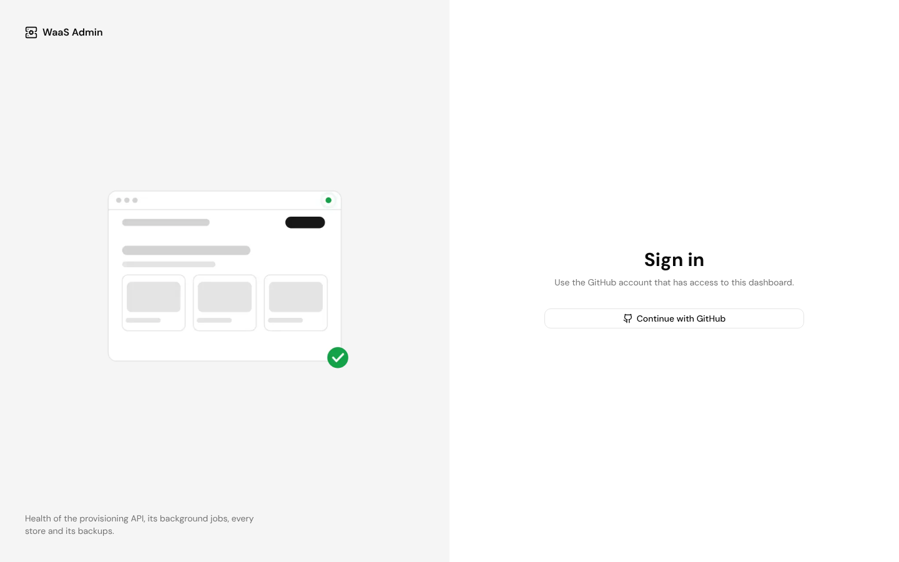 | 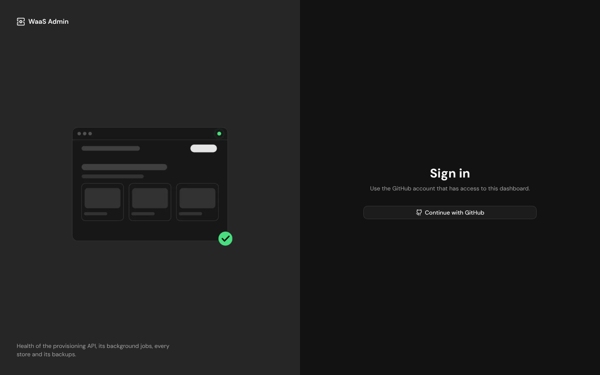 |
| 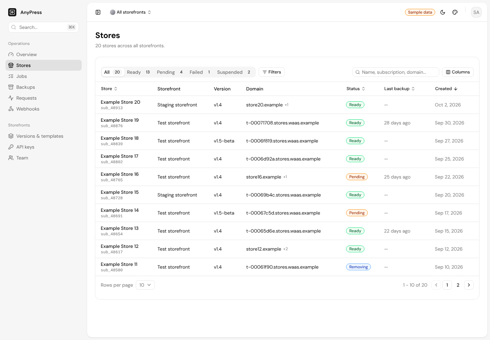 | |
| 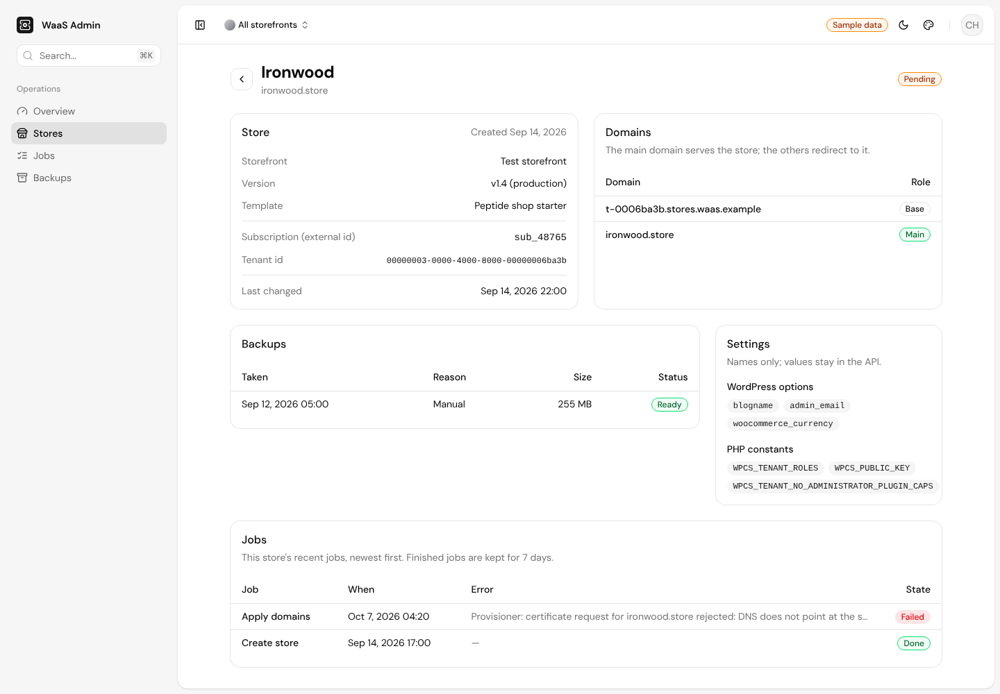 | 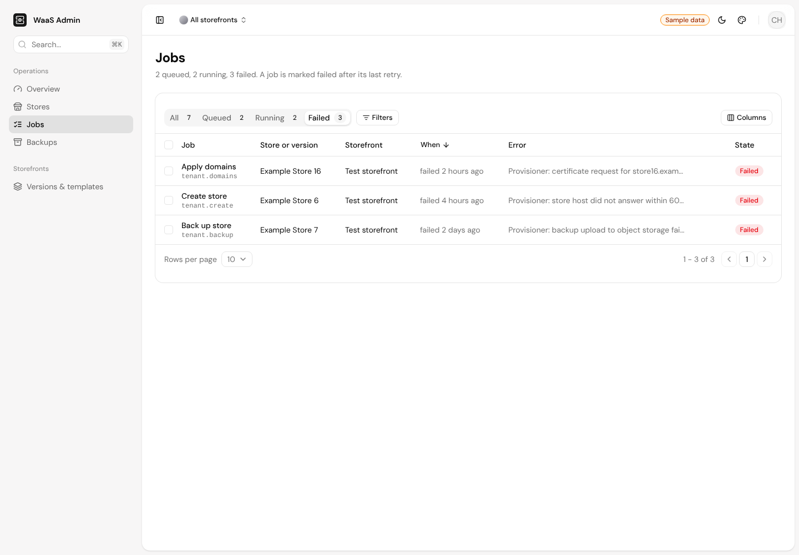 |
| 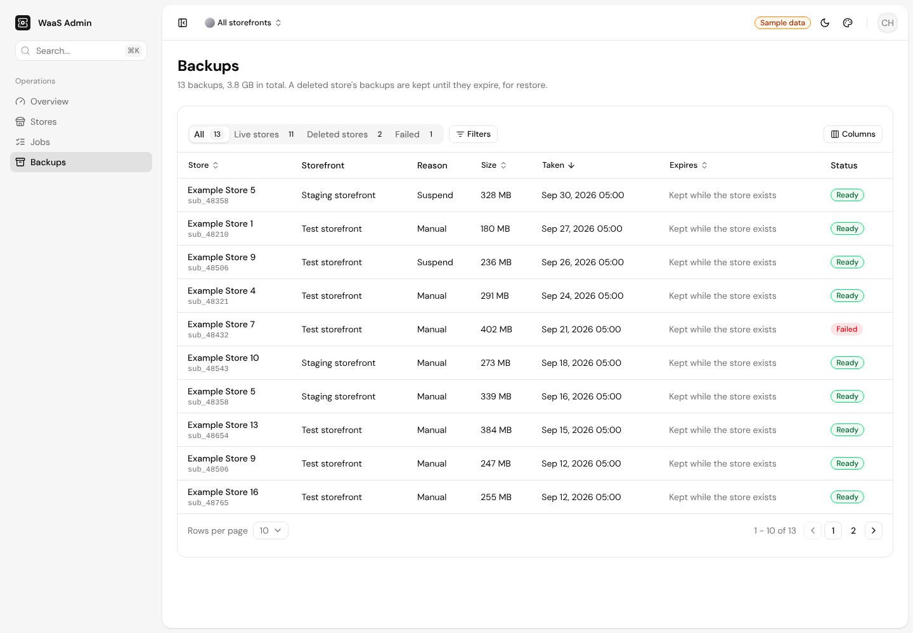 | 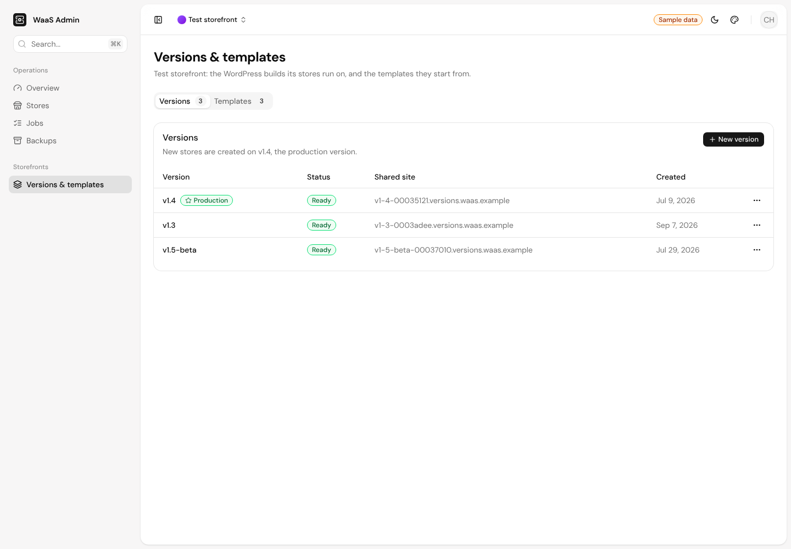 |
| 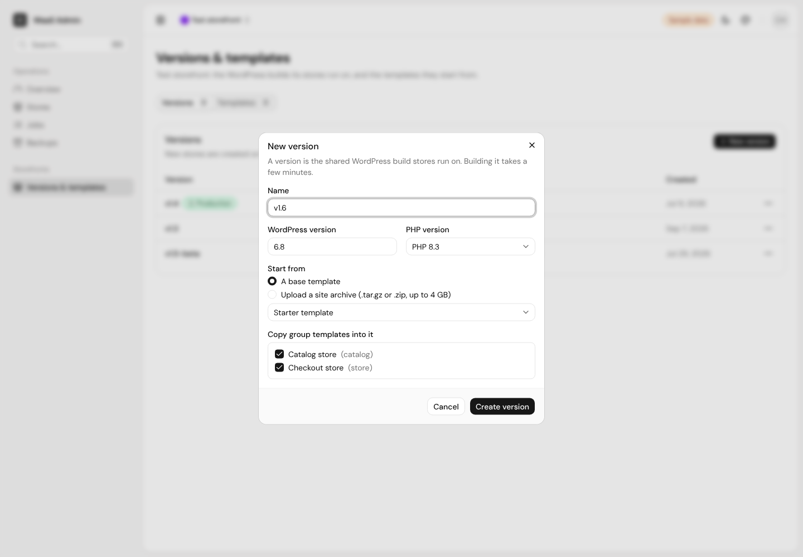 | 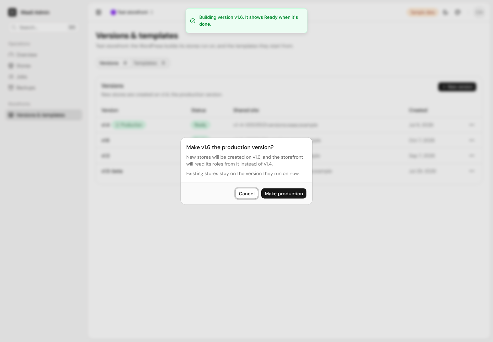 |
| 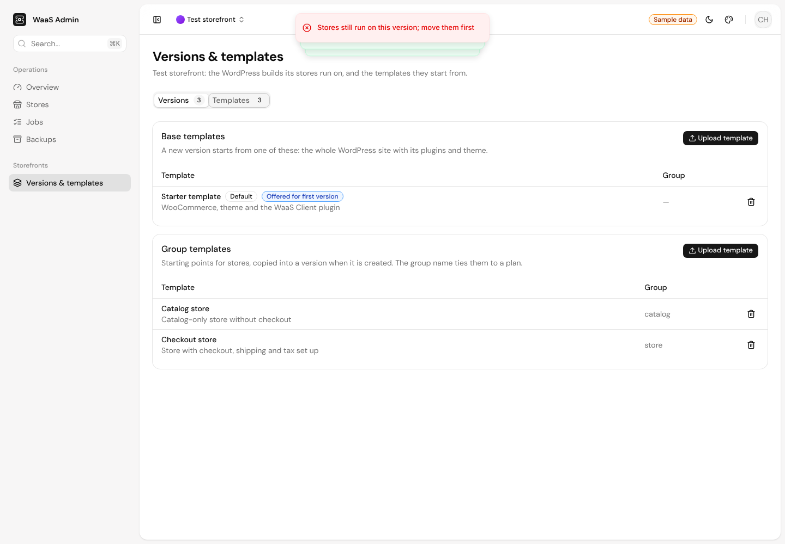 | 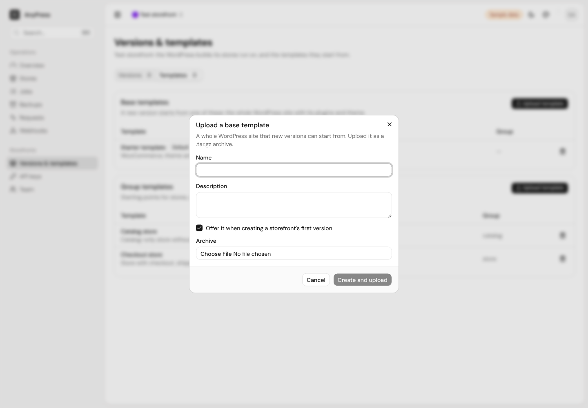 |
| 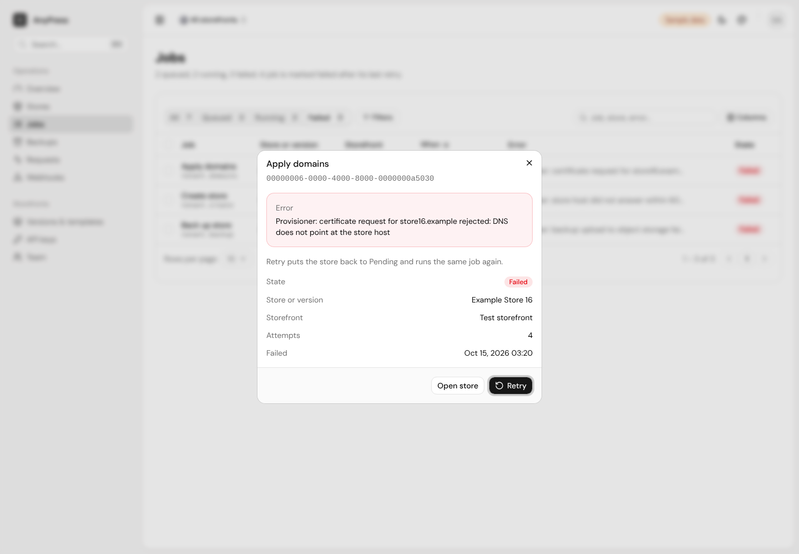 | 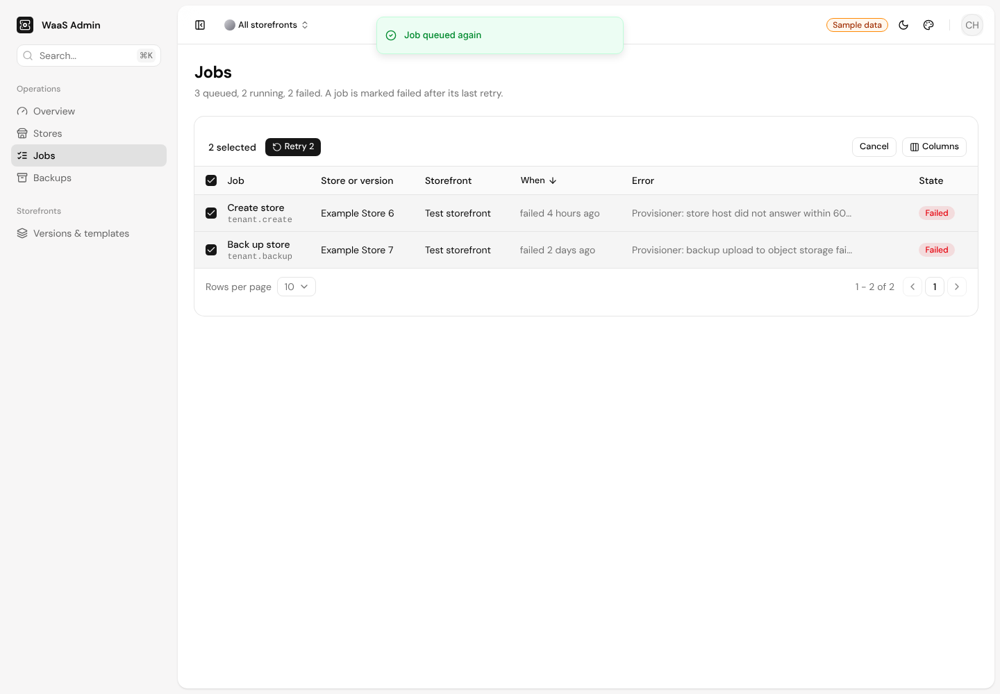 |

## History

Every pull request so far, with its description and Beads issue, is listed in [docs/history.md](docs/history.md).

## License

GPL-3.0-or-later. See [LICENSE](LICENSE). The shadcn/ui components in `components/ui/` stay under shadcn/ui's MIT license.
